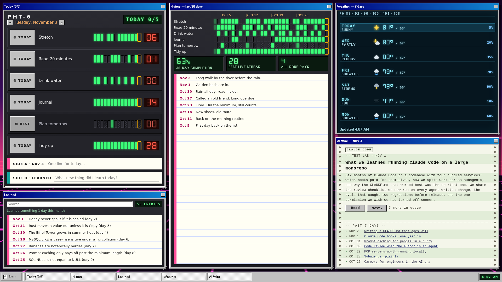
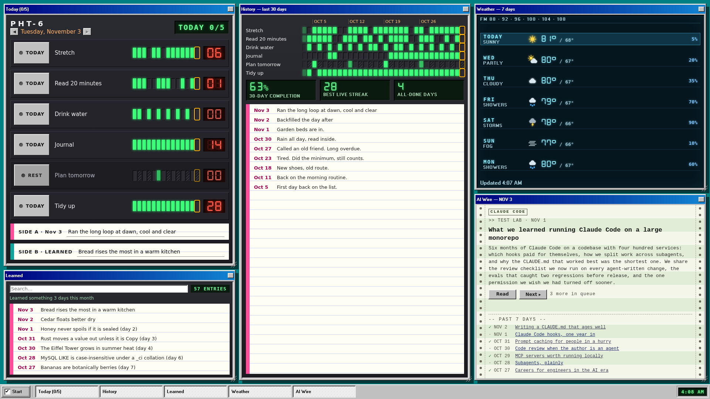
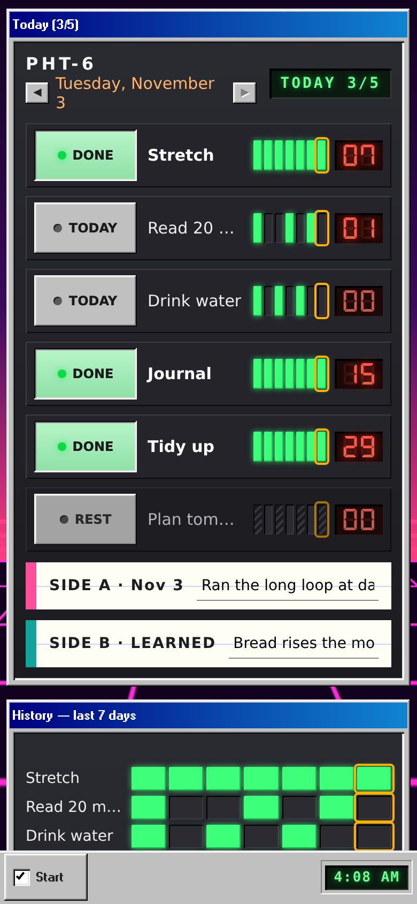
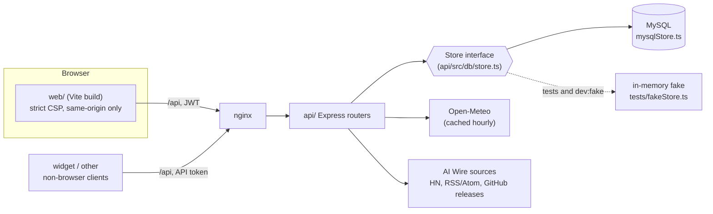

# PHT

[](https://github.com/elijahsylar/pht/actions/workflows/ci.yml)

A single-user daily habit tracker: one check per habit per day, an optional one-line note, a "learned today" line, streaks that respect rest days, a 7-day weather window, and one curated AI-engineering article a day. The page is a Windows 98 desktop with snap-grid windows and 1980s hardware inside them. Underneath the styling it is a small, heavily tested full-stack app: a TypeScript API over a storage interface with two implementations, a dependency-free frontend, and deploy scripts built to make the obvious mistakes impossible.



| Teal theme | Phone |
|---|---|
|  |  |

Screenshots show the synthetic data served by `npm run dev:fake`.

## Repository layout

```
api/    Express + MySQL API (TypeScript), deploy and backup scripts in api/ops/
web/    the page: TypeScript + Vite, 98.css, no framework
docs/   DEPLOY.md, screenshots
scripts/dev.sh   run both halves on synthetic data
scripts/test.sh  run both unit/route test suites
```

## Architecture



- **One persistence interface.** Every route talks to a `Store`. `mysqlStore.ts` is the real one; `tests/fakeStore.ts` is an in-memory one typed against the same interface, so changing the interface breaks the test build until the fake follows. One behaviour suite (`tests/storeContract.ts`) runs against both: against the fake in the normal run, and against a real MySQL 8.4 in Docker in `npm run test:mysql`.
- **Pure domain modules.** Streaks, schedules (daily, every other day, chosen weekdays; rest days never break a streak) and date handling live in `api/src/lib/` with no I/O. "Today" always comes from the user's configured IANA time zone, never the server's clock zone.
- **The page** (`web/`) is plain TypeScript with a small shared store and no UI framework. Its Content-Security-Policy allows only same-origin scripts, styles, fonts and requests, with no inline code; the deploy script refuses a build that weakens it.

## Stack

- API: Node.js, Express 4, TypeScript, Zod, mysql2, bcrypt, jsonwebtoken
- Database: MySQL 8.4
- Web: TypeScript, Vite, 98.css, DSEG fonts
- Tests: Vitest and Supertest (API), Vitest (web), Playwright with Chrome and Firefox (UI walkthrough), Docker for the real-MySQL suite
- Ops: bash, nginx, pm2, cron, systemd timers

## Technically notable parts

**Authentication.** Login is two steps: password, then a security answer, both stored as bcrypt hashes. The resulting browser session is a 30-day JWT that slides: a request in the token's last 7 days gets a fresh token in a response header. Logging out or changing the password records a cutoff instant, and every browser token issued before it is refused (millisecond issue times, because JWT `iat` is too coarse to order a token against a logout in the same second). Both login steps are attempt-limited per client IP and per account, with doubling lockouts; an attempt is counted before the credential is checked, so parallel requests cannot outrun the limit, and an address that recently completed a full login is exempt from the account lock, so knowing the user name is not enough to lock the owner out from an address they recently logged in from. Non-browser clients use one long-lived API token, stored only as a hash and rotated with a script. The API sends no CORS headers at all.

**AI Wire without a model.** One article a day, the same on every device. Sources are fetched at most once per 15 minutes per process from an allowlist of hosts (robots.txt is honoured for index pages), deduplicated by canonical URL and by title hash, passed through a keyword "career gate" with topic tiers and competitor rules, then ranked. Candidates stay in a 24-hour pool, so one failing source does not empty the day. There is deliberately no LLM call in the selection.

**Release and rollback.** Versioned releases with an atomic symlink flip, a branch guard that only deploys a clean `main` identical to `origin/main`, a frontend artifact check, HTTP verification of what is actually being served, and one-command rollback. Nightly dumps are only kept if they prove complete. Details in [docs/DEPLOY.md](docs/DEPLOY.md).

**Test setup.** Measured on the current code:

| Suite | Command | Result |
|---|---|---|
| API unit and route tests (fake store) | `cd api && npm test` | 271 passed, 59 skipped (302 passed with a production web build at the path the frontend-artifact tests read: their 31 checks need one) |
| API on real MySQL 8.4 (Docker) | `cd api && npm run test:mysql` | 28 passed |
| Web unit tests | `cd web && npm test` | 61 passed |
| Browser walkthrough (Chrome walkthrough, Chrome and Firefox grid checks) | `cd web && npm run ui:check` | 654 checks passed |

Some tests exist to keep the deploy scripts honest: the branch guard is exercised against throwaway git repositories with a local remote, and the frontend artifact check is run against 28 copies of a real build, each broken in one specific way.

## Running locally

Requirements: Node.js 20 or newer.

```bash
git clone https://github.com/elijahsylar/pht.git
cd pht
scripts/dev.sh
```

This installs dependencies on first run, starts the API on `127.0.0.1:4100` over an in-memory store filled with synthetic data, and serves the page on `http://127.0.0.1:5173`. The demo login and security answer are printed by the API when it starts. Data resets when it stops.

To run against MySQL instead, create a database and user, copy `api/.env.example` to `api/.env`, fill it in, then:

```bash
cd api
npm run migrate
npm run dev
```

### Tests

```bash
scripts/test.sh                 # installs dependencies on first run, then API + web unit and route tests
cd api && npm run test:mysql    # needs Docker and the mysql:8.4 image
cd web && npm run ui:check      # needs Google Chrome at /usr/bin/google-chrome
```

## Project status

A personal tool in daily use by one person. It is intentionally single-user (one admin account, one API token) and is not designed for multiple accounts.

## License

MIT. See [LICENSE](LICENSE). 98.css is by Jordan Scales (MIT); the MS Sans Serif font is CC BY-SA 3.0 (`web/public/vendor/98css/`).
